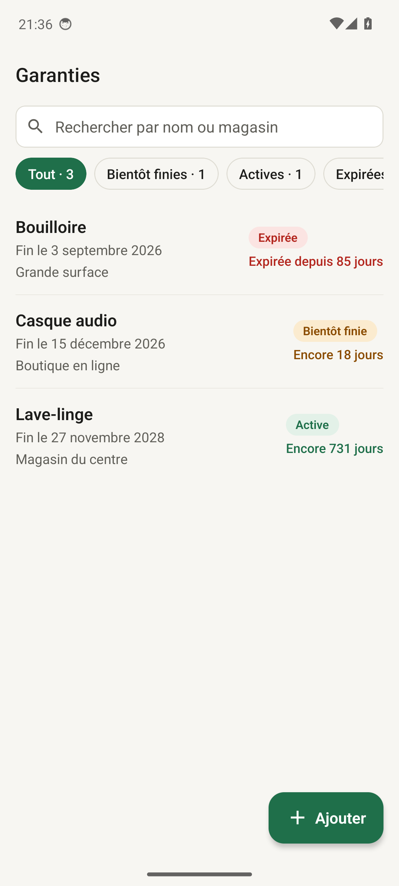
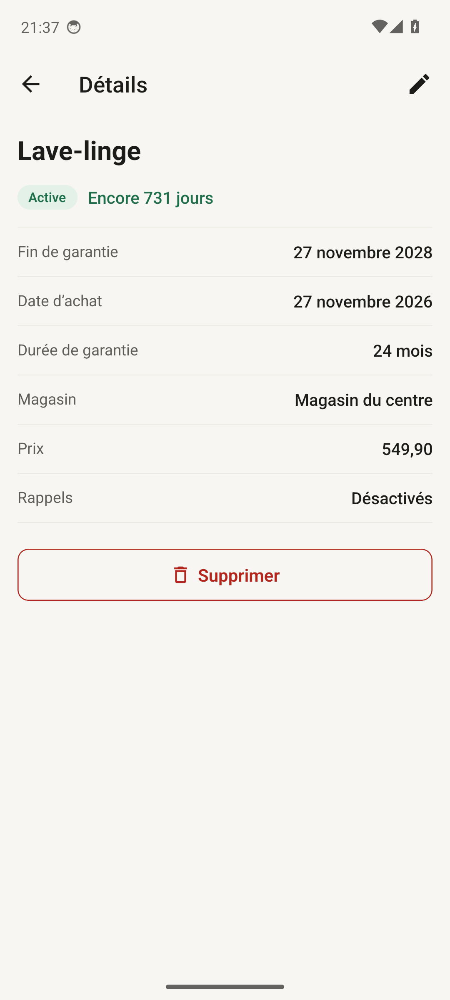
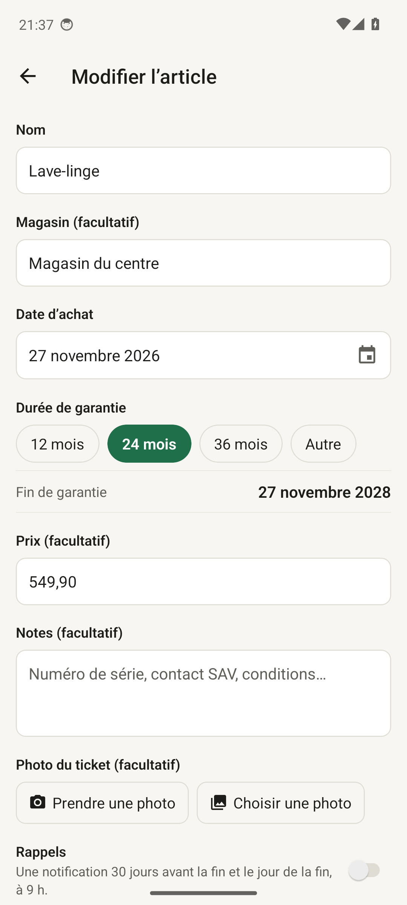
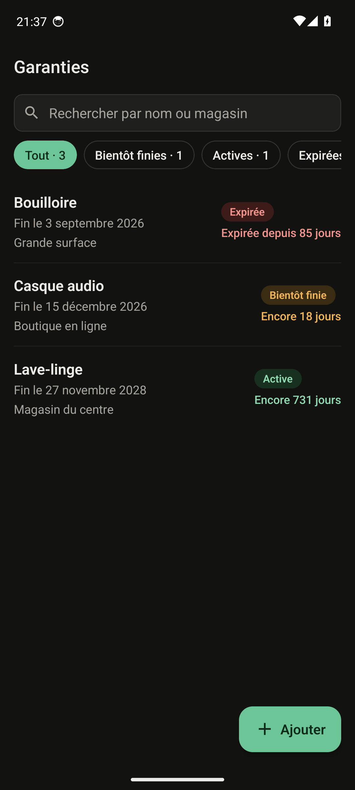

# Garanties (Warranty Keeper)

[English](README.md)

Une petite app Android pour noter ce que vous achetez et la date de fin de chaque garantie, pour ne plus rater un retour en garantie. Hors ligne, sans compte, sans publicité, sans traceur.

## Captures

Prises sur un émulateur Android (API 34, 1080x2400) par la CI, avec des articles d’exemple saisis dans l’app :

| Liste | Détails | Modification | Thème sombre |
| --- | --- | --- | --- |
|  |  |  |  |

Les anciens aperçus web (`expo export --platform web`) restent dans `docs/screenshots/` pour référence.

## Fonctionnalités

- Articles triés par date de fin de garantie, avec un badge (active, bientôt finie à 30 jours ou moins, expirée) et le nombre de jours restants.
- Ajouter, modifier, supprimer un article : nom, magasin, date d’achat, durée de garantie (12, 24, 36 mois ou autre), date de fin calculée, prix, notes.
- Photo du ticket facultative, prise avec l’appareil photo ou choisie dans la galerie, copiée dans le stockage privé de l’app.
- Rappels facultatifs : une notification locale 30 jours avant la fin et le jour de la fin (à 9 h). L’autorisation n’est demandée qu’à l’activation des rappels.
- Recherche par nom ou magasin, filtre par statut.
- Français et anglais (selon la langue du téléphone), thème clair et sombre.

## Confidentialité

Aucune donnée ne quitte le téléphone. Les articles et les photos restent sur l’appareil (SQLite et dossier privé de l’app). Aucun appel réseau, aucune mesure d’audience, aucun compte. Voir [PRIVACY.md](PRIVACY.md).

## Compiler

Prérequis : Node 22, JDK 17, SDK Android.

```bash
npm ci
npm run typecheck && npm run lint && npm test
npx expo prebuild --platform android
cd android && ./gradlew assembleRelease
```

L’APK se trouve dans `android/app/build/outputs/apk/release/`. Il est signé avec la clé de débogage du modèle : suffisant pour tester, pas pour le Play Store.

Le workflow GitHub Actions (`.github/workflows/android.yml`) lance les vérifications, compile l’APK, prend des captures sur un émulateur et joint l’APK à une release pour les tags `v*`.

Seul Android est testé, pas iOS.

## Licence

[MIT](LICENSE) © 2026 Firas Hmedi
