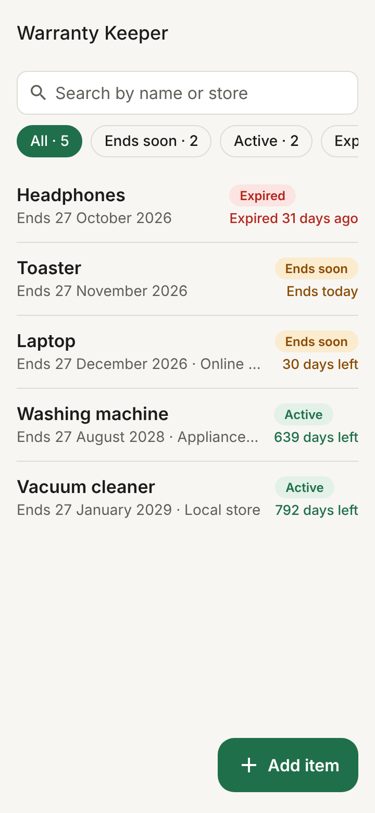
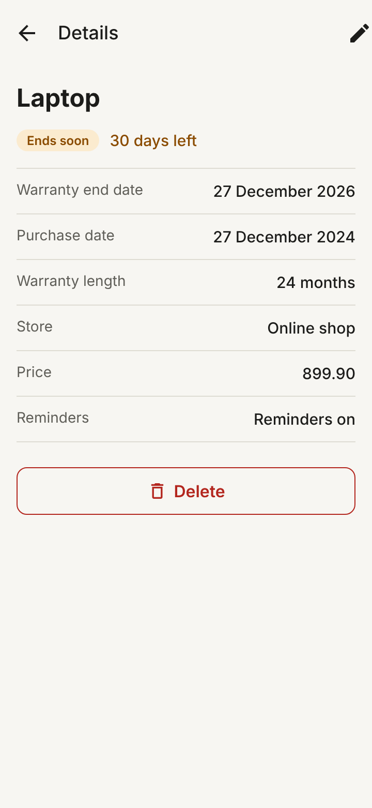
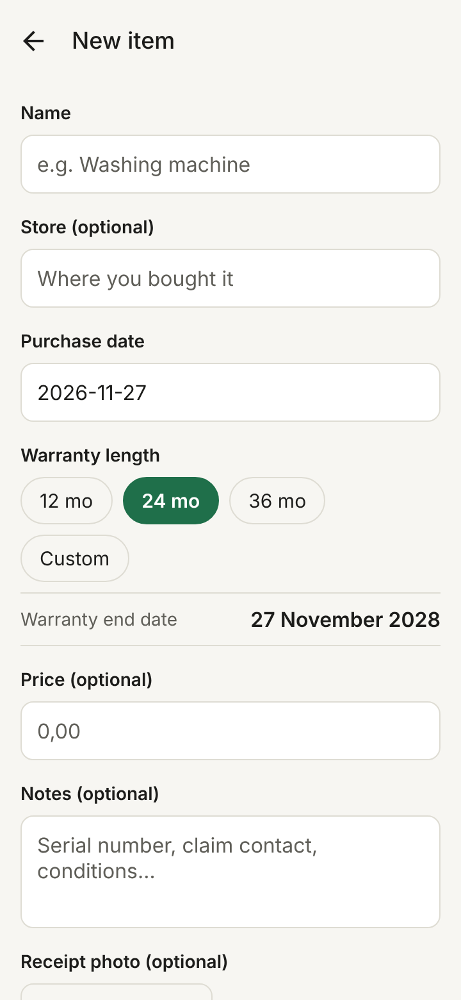

# Warranty Keeper (Garanties)

[Français](README.fr.md)

A small Android app to keep track of what you bought and when each warranty ends, so you never miss a warranty claim. Offline, no account, no ads, no tracking.

## Screenshots

Web preview (rendered from the same code with `expo export --platform web` and sample data; Android screenshots will come from CI):

| List | Details | Add item |
| --- | --- | --- |
|  |  |  |

## Features

- Items sorted by warranty end date, with a status badge (active, ends soon within 30 days, expired) and the days remaining.
- Add, edit and delete items: name, store, purchase date, warranty length (12, 24, 36 months or custom), computed end date, price, notes.
- Optional receipt photo from the camera or the gallery, copied into the app’s private storage.
- Optional reminders: a local notification 30 days before the end date and on the end date (9:00). Permission is asked only when you turn reminders on.
- Search by name or store, filter by status.
- French and English (follows the phone language), light and dark theme.

## Privacy

No data leaves the phone. Items and photos are stored only on the device (SQLite and the app’s private folder). No network calls, no analytics, no account. See [PRIVACY.md](PRIVACY.md).

## Build locally

Requirements: Node 22, JDK 17, Android SDK.

```bash
npm ci
npm run typecheck && npm run lint && npm test
npx expo prebuild --platform android
cd android && ./gradlew assembleRelease
```

The APK is in `android/app/build/outputs/apk/release/`. It is signed with the template’s debug key: fine for testing, not for the Play Store.

The GitHub Actions workflow (`.github/workflows/android.yml`) runs the checks, builds the APK, takes screenshots on an emulator and attaches the APK to a release for `v*` tags.

Only Android is tested. iOS is not.

## License

[MIT](LICENSE) © 2026 Firas Hmedi
